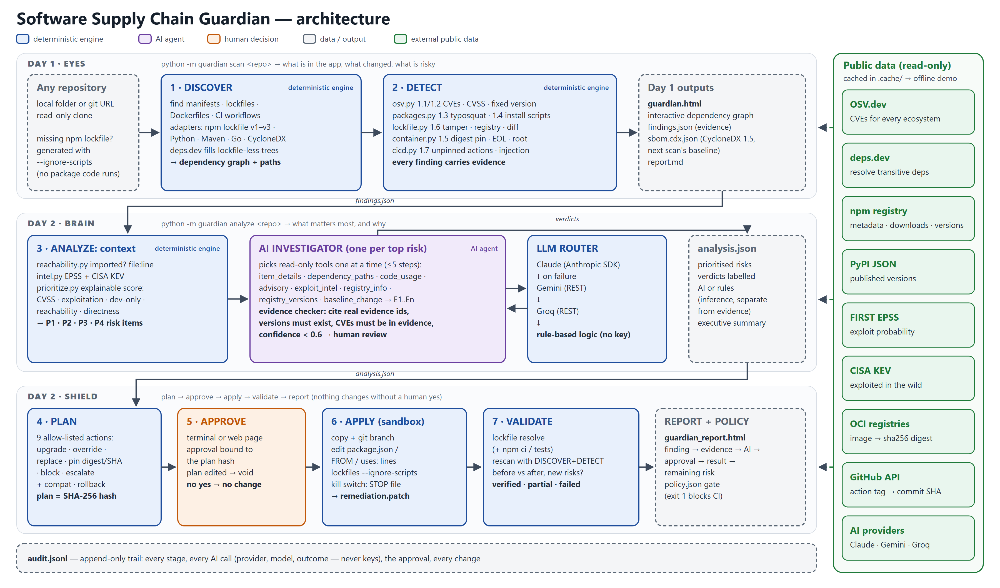

# Software Supply Chain Guardian

*Know what you build. Trust what you ship.*

An agent that analyses **any** repository's software supply chain: it discovers every component,
builds the dependency graph, detects vulnerable dependencies and suspicious changes with evidence
(Day 1, the **Eyes**), then prioritises them in context with AI, proposes allow-listed fixes, waits for
human approval, applies them in a sandbox, and proves the result by rebuilding and rescanning
(Day 2, the **Brain & Shield**).

## Quick start (Windows, PowerShell)

```powershell
git clone https://github.com/Vishnu868/BGSW.git; cd BGSW
python scripts\setup.py                             # portable Node.js (checksum-verified) + demo target repos
python -m guardian scan targets\juice-shop          # any folder or git URL works
python -m guardian scan https://github.com/snyk-labs/nodejs-goof
python -m http.server 8765 --directory runs         # open http://localhost:8765/juice-shop/guardian.html
python -m unittest discover -s tests                # 22 offline regression tests
```

No pip install needed: the Guardian uses only the Python 3.11+ standard library.
`tools/node` holds a portable Node.js used only to generate missing npm lockfiles
(`npm install --package-lock-only --ignore-scripts`, so no package code ever runs).

### "What changed" demo
```powershell
python scripts\simulate_pr.py targets\juice-shop    # local copy with a tampered lockfile (nothing published)
python -m guardian scan targets\juice-shop-pr --baseline runs\juice-shop\sbom.cdx.json --no-lockgen
```
Detects: swapped integrity hash (critical), download host changed to a non-official registry,
a new dependency that runs an install script, and a downgrade.

## Architecture



(Regenerate with `python scripts/make_architecture.py`.)

## Pipeline

```
repo / git URL
  │
  ├─ 1. DISCOVER  guardian/discover/
  │     find manifests, lockfiles, Dockerfiles, compose files, CI workflows
  │     adapters: npm (lockfile v1/v2/v3, workspaces) · Python (requirements, poetry.lock, Pipfile.lock)
  │               Maven (pom.xml) · Go (go.mod) · existing CycloneDX SBOMs (consume)
  │     resolve.py: transitive deps for lockfile-less projects via deps.dev (labelled as "resolved")
  │     -> dependency graph: nodes = components, edges = "depends on", paths, "introduced by"
  │
  ├─ 2. DETECT    guardian/detect/            (all deterministic, every finding carries evidence)
  │     osv.py        1.1 / 1.2 known vulnerabilities (OSV.dev, all ecosystems), CVSS computed, fixed version,
  │                   path back to the direct dependency; MAL- entries = malicious packages (1.3)
  │     packages.py   1.3 look-alike names confirmed by download counts; npm registry: package name vs
  │                   claimed source repo + publisher (starjacking); 1.4 install scripts + risky commands
  │     lockfile.py   1.6 non-official registry / http / git sources, missing or conflicting integrity,
  │                   manifest-lockfile drift, unpinned requirements; baseline diff (tamper, added, downgrade)
  │     container.py  1.5 no digest pin / latest tag, EOL base images, root user, curl|sh, remote ADD
  │     cicd.py       1.7 actions not pinned to a SHA, write-all, pull_request_target + PR checkout,
  │                   script injection from untrusted event fields inside run: blocks
  │
  └─ 3. REPORT    guardian/report/
        guardian.html   interactive graph (risk / direct / full views, search, click -> path + evidence),
                        findings table, what changed, inventory, scan notes. Self-contained, works offline.
        findings.json   machine-readable (guardian.findings/v1)
        report.md       human-readable
        sbom.cdx.json   CycloneDX 1.5 SBOM with dependencies + vulnerabilities (also next scan's baseline)
```

```
  ├─ 4. ANALYZE   guardian/analyze/        python -m guardian analyze <repo>
  │     reachability.py  is the package imported by app code? (file:line evidence)
  │     intel.py         EPSS exploit probability + CISA Known-Exploited list (public, no key)
  │     prioritize.py    explainable 0-100 score: CVSS, exploitation, dev-only, reachability, directness -> P1..P4
  │     agent.py         AI investigator: model picks read-only tools one at a time (evidence E1..En);
  │                      evidence checker removes uncited claims, non-existent versions, unknown CVEs;
  │                      confidence < 0.6 -> human review; no key -> same questions answered by rules
  ├─ 5. REMEDIATE guardian/remediate/      plan -> approve -> apply
  │     planner.py       allow-listed actions only (upgrade, override, replace typosquat, pin digest/SHA, block,
  │                      escalate), each with rationale, risk reduction, compatibility, rollback; plan = SHA-256 hash
  │     approval.py      human approval bound to the plan hash (terminal or local web page)
  │     apply.py         refuses without approval / if plan changed / kill switch (runs/<repo>/STOP); applies in a
  │                      sandbox git branch, regenerates lockfiles with --ignore-scripts, writes remediation.patch
  ├─ 6. VALIDATE  guardian/validate/       rebuild (lockfile resolve, optional npm ci / tests), rescan, before vs after,
  │                                        new findings check, per-action verdict, follow-up for what remains
  └─ 7. REPORT    guardian/report/final.py guardian_report.html/.md/.json: finding -> evidence -> AI inference ->
                                           approved action -> result -> remaining/accepted risk -> audit trail
     guardian/policy.py + config/policy.json   policy-as-code CI gate (exit 1 on violation)
     guardian/llm/   one interface for Claude (official SDK), Gemini, Groq + automatic fallback chain
```

## AI providers (Claude, Gemini, Groq)

Copy `.env.example` to `.env` and add any key you have. `LLM_PROVIDER=auto` tries Claude, then Gemini, then Groq,
then rule-based logic, so the demo never breaks because of a key or a rate limit.

```powershell
pip install -r requirements.txt        # only needed for Claude (official anthropic SDK)
python -m guardian llm-check           # pings each configured provider
```
- Claude: `ANTHROPIC_API_KEY`, model `CLAUDE_MODEL` (default `claude-opus-5-5`), effort `CLAUDE_EFFORT`.
- Gemini: `GEMINI_API_KEY` (free key at aistudio.google.com), `GEMINI_MODEL`.
- Groq: `GROQ_API_KEY` (free key at console.groq.com), `GROQ_MODEL`.
If a model name is retired, `llm-check` prints the models the key can use.

## Day 2 quick start
```powershell
python -m guardian analyze juice-shop            # priorities + AI investigation  -> analysis.md
python -m guardian plan juice-shop               # remediation plan               -> plan.md
python -m guardian approve juice-shop --web      # human approval (http://127.0.0.1:8770)
python -m guardian apply juice-shop              # sandbox branch + remediation.patch
python -m guardian validate juice-shop           # rescan, before/after, verdict
python -m guardian report juice-shop             # runs/juice-shop/guardian_report.html
python -m guardian policy juice-shop             # CI gate
python -m guardian run targets
odejs-goof       # the whole loop on another repo
```

## Tested on (same code, no changes)

| Repo | Ecosystem | Components | Highlights |
|---|---|---|---|
| OWASP Juice Shop | npm (server + Angular frontend) | 1,656 (154 direct) | jsonwebtoken 0.4.0 CVE chain, `ngy-cookie` typosquat (claims `salemdar/ngx-cookie`), unpinned 3rd-party actions, EOL node:20 images |
| snyk-labs/nodejs-goof | npm (committed lockfile v2) | 980 | many vulnerable transitive deps, old base image |
| pygoat | Python (25 requirements files) | 98 (39 transitive via deps.dev) | old Django CVEs, unpinned requirements, many Dockerfiles |

## Safety and responsible AI
- Read-only analysis: target repos are cloned, never built or executed; install scripts are never run.
- Network calls only to public, read-only data sources: OSV.dev, deps.dev, the npm registry; results cached in `.cache/`
  so the demo also runs `--offline`.
- No credentials used or stored. Nothing is published or pushed.
- Findings are deterministic evidence (`evidence_type: verified`); AI output is labelled inference, must cite
  evidence ids, and is checked (non-existent versions/CVEs removed, low confidence escalated).
- Every change needs explicit human approval bound to the plan hash; changes happen only in a sandbox branch;
  nothing is merged, pushed or published. Kill switch: create `runs/<repo>/STOP`.
- Keys live only in `.env` (git-ignored), are never logged; the audit trail records provider/model, not prompts or keys.

## Known limitations
- npm gives exact graphs; requirements.txt / pom.xml graphs are resolved by deps.dev (what a fresh install would get).
- Go: go.mod indirect modules are attached to the root (no `go mod graph`).
- Reachability is import-level (is the package loaded?), not call-graph level (is the vulnerable function called?).
- Validation runs lockfile resolution + rescan by default; full `npm ci` / test suites are opt-in (slow).
- The popular-package list for look-alike checks is a small curated sample (`guardian/data/`).
